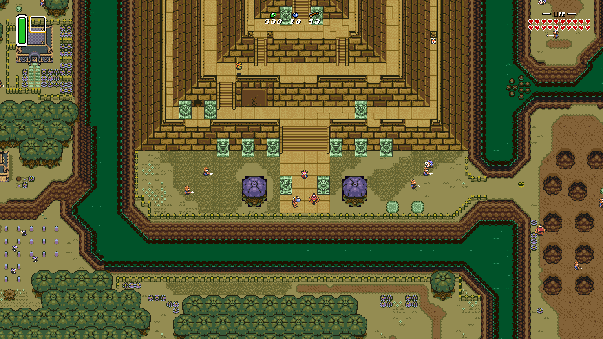
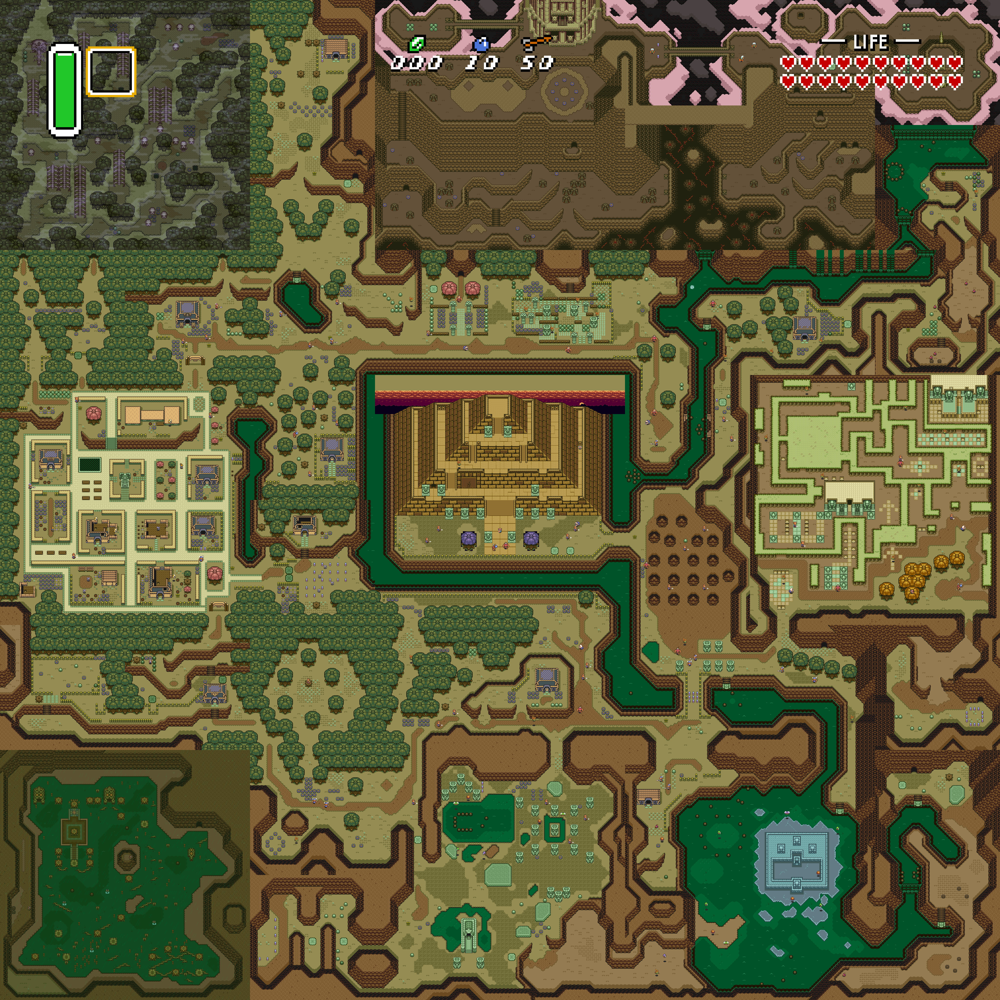
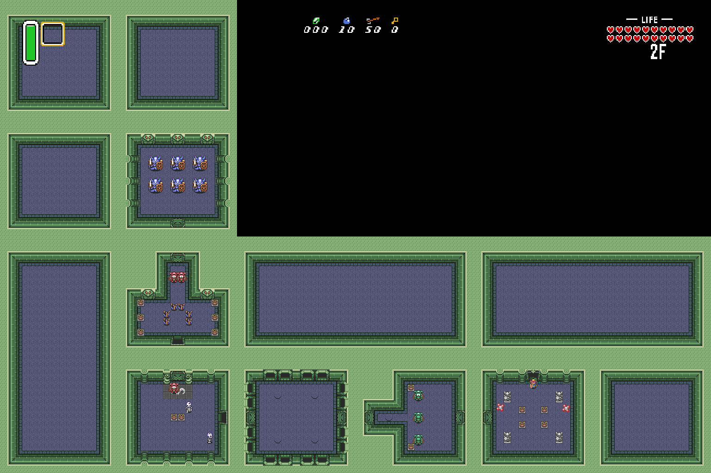

# ZeldaAlttPSNESRecomp

> _This recompilation is a **byproduct of developing
> [snesrecomp](https://github.com/mstan/snesrecomp)** — the games are the proving ground, the framework is the goal.
> **These are in-development previews, not finished ports — expect rough
> edges**, and depth will keep landing over months, not days. My time for any
> one title is limited, so I ask for your patience. Contributions are welcome —
> testing, issues, and PRs to the game or framework all help and will
> accelerate this game's polish. More on the why at:
> [Recomp + AI: 5 Months Later »](https://1379.tech/recomp-ai-5-months-later/)_

Static recompilation of *The Legend of Zelda: A Link to the Past* (SNES)
into native C, using the [snesrecomp](https://github.com/mstan/snesrecomp)
framework. This repo is the per-game side: the runtime, the recompiled C
output, the per-game `.cfg`, and the build glue.

## What "static recompilation" means here

The 65816 CPU code from the ROM is statically translated to C — every
function the game runs on the SNES's main CPU is a real generated C
function in `src/gen/`. **The rest of the SNES is not recompiled** —
it's hardware. PPU rendering, the APU/SPC700 audio coprocessor, DMA and
HDMA channels, hardware register I/O, and bank-mapping all run through
an embedded copy of snes9x's emulator core
(`snesrecomp/runner/snes9x-core/`). Same model as N64Recomp and similar
projects: recompile the CPU, emulate the silicon.

The ROM is **never** redistributed — you supply your own legally-dumped
copy.

**New:** [Seamless World](#seamless-world-experimental) is available as an
experimental launcher mod, with live expanded worlds, zoom and connected
dungeon floors. [Download the Windows experimental release](https://github.com/mstan/ZeldaAlttPSNESRecomp/releases/tag/v0.7.0-experimental.1).

## Current status

Hand-verified end-to-end through:

- Boot → attract demo → file select → in-game.
- **Module 09 (Overworld)** reachable and traversable.
- **Module 07 (Dungeon)** including sword combat — the bug from
  v0.1.0's release-note investigation (camera axis-swap on sword hit)
  is fixed.
- Audio (HLE SPC upload of the cartridge's stock sound engine) plays
  through title, gameplay, sword/item SFX, and music transitions.

The original route checks above cover the early game. Seamless World also has
focused later-game, Dark World and dungeon checks, described below and in
[its validation notes](docs/SEAMLESS-WORLD.md). These checks do not establish
a complete playthrough or an audit of every quest and boss. If you hit a
visible regression, please open an issue with reproduction steps and a
current-build savestate.

Active development; expect:

- Some branches don't build; only `main` is guaranteed to build.
- Internal docs (`ISSUES.md`) assume context.
- APIs and recompiler output change without notice.

## Quick start (pre-built release)

1. Download the latest release zip from [Releases](../../releases) and
   extract it.
2. Run `ZeldaALttPSNESRecomp.exe`. On first launch a file picker asks for your
   **legally-obtained** *Legend of Zelda: A Link to the Past (USA)* ROM
   (`.sfc` / `.smc`). The expected CRC32 is `0x777AAC2F` (no-intro
   canonical USA dump, 1 MiB, LoROM). 512-byte SMC copier headers are
   auto-stripped before hashing, so headered or unheadered both work.
3. Edit `keybinds.ini` (auto-generated next to the exe on first run) to
   remap keys, then restart.

The path you pick is cached to `rom.cfg` next to the exe so subsequent
launches skip the picker.

## Controls (default `keybinds.ini`)

| SNES button | Default key |
|-------------|-------------|
| D-Pad       | Arrow keys |
| A           | X |
| B           | Z |
| X           | S |
| Y           | A |
| L           | C |
| R           | V |
| Start       | Enter |
| Select      | Right Shift |

Player 2 is unbound by default — fill in keys in `keybinds.ini` to
enable a second keyboard player.

**Xbox / PlayStation / Switch Pro controllers** are auto-detected via
SDL_GameController (XInput on Windows). Plug it in before launching, or
hot-plug after.

System shortcuts (configured in `config.ini`'s `[KeyMap]` section):

| Action               | Default |
|----------------------|---------|
| Save state 1-10      | Shift+F1..F10 |
| Load state 1-10      | F1..F10 |
| Toggle pause         | P |
| Reset                | Ctrl+R |
| Toggle fullscreen    | Alt+Enter |
| Turbo (fast-forward) | Tab |

## Adaptive widescreen

Enable **Adaptive view** in the launcher, or set `Widescreen = 1` under
`[Graphics]` in `config.ini`. The logical height remains 224 pixels while the
logical width follows the live window or fullscreen aspect ratio. Resizing a
window wider therefore reveals more of the overworld or dungeon instead of
stretching a fixed 16:9 image. At the native aspect the renderer returns to the
authentic 256-pixel view; at 16:9 it is about 398 pixels wide.

The status HUD's left and right groups remain anchored to their respective
edges. Room bounds still win over the requested width, so areas without valid
terrain pillarbox rather than exposing wrapped tile data. The maximum logical
width is 446 pixels because wider views cannot represent every sprite safely in
the SNES's 9-bit OAM coordinate space.

## Building from source

Prerequisites: Windows 10+, Visual Studio 2022 (with C++ desktop
workload), Python 3.9+ on PATH, and `rustup` for regeneration.

```bash
git clone https://github.com/mstan/ZeldaAlttPSNESRecomp
git clone https://github.com/mstan/snesrecomp
cd ZeldaAlttPSNESRecomp
```

The `snesrecomp/` directory is a [sibling repo](https://github.com/mstan/snesrecomp)
accessed via a junction/symlink to the clone next to this repo.

Build:

```bash
# From a Developer Command Prompt for VS 2022, or with MSBuild on PATH:
msbuild zelda.sln /p:Configuration=Oracle /p:Platform=x64 /m
```

The recompiled C in `src/gen/` is **not** committed — contributors must
regenerate it from a local ROM before the first build. See the next
section.

### Regenerating the recompiled C (contributors)

1. Drop a legally-obtained **stock** `zelda.sfc` at the repo root
   (`.gitignore` excludes it).
2. Run:
   ```bash
   bash tools/regen.sh            # add --no-tests to skip the framework suite
   ```
   This applies the bundled MSU-1 patch to a throwaway copy of your stock
   ROM (`tools/apply_msu_patch.py`), regenerates `src/gen/` from the
   patched image, and syncs `recomp/funcs.h`. Your stock ROM is left
   untouched and is what you load at runtime. The script builds and requires
   the fast native analyzer; set `SNESRECOMP_ANALYSIS_BACKEND=python` only to
   run the slower reference implementation.
3. Rebuild as above.

## Seamless World (experimental)

Explore beyond the original screen boundaries. **Seamless World** presents the
Light World and Dark World as live, continuous maps, and shows connected rooms
on the current dungeon floor. Zoom out to see more of the game while enemies,
items and projectiles continue to run using the game's native routines.



Enable **Seamless World** in the launcher's **Mods** page in the
[Windows experimental release](https://github.com/mstan/ZeldaAlttPSNESRecomp/releases/tag/v0.7.0-experimental.1).
It is marked **Experimental** and **disabled by default**. Supply the stock
USA ROM; no ROM patch or separate map download is needed.

- **Continuous overworld:** ordinary area crossings keep the camera moving
  with Link. Actors retain their state across crossings, with combat, pickups,
  carried objects and projectiles working across area boundaries.
- **Connected dungeon floors:** see neighboring rooms together while native
  doors, keys, shutters and pressure plates retain their behavior. Stairs and
  pits still take their authored routes between floors and rooms.
- **Adjustable view:** resize the window to reveal more in either direction,
  use the **mouse wheel** to change zoom, or press **F4** to toggle the whole
  current world or dungeon floor. F4 is separate from the game's original map.
- **Native presentation and travel:** the HUD follows the actual viewport;
  inventory, dialogue and the original game map keep their controls. Caves,
  special entrances, warps and Light/Dark World changes keep native routing.



*F4 reveals the whole current world. This is the live game view; visible
terrain and actors come from the supplied ROM.*



*A connected dungeon floor. Native stairs change the current floor.*

In the camera-following view, visible areas and a surrounding halo simulate;
other areas retain their state. The whole-map view activates the entire
current world or floor, so **large views can slow down**. Full-map 60 FPS is
not a requirement for this experiment.

This preview is for **local play**. Representative checks cover terrain,
rendering, boundary interactions, weapons, NPCs, puzzles, dungeon travel and
current-build save/load and replay. Full-game coverage, every enemy/quest
variant, netplay and Linux/macOS runtime qualification remain open. See
[the burndown and validation notes](docs/SEAMLESS-WORLD.md) for specific limits.
Native in-game saves remain separate from build-specific save states. Stock
presentation, adaptive widescreen and MSU-1 remain available.

## MSU-1 audio

This build supports [MSU-1](https://sneslab.net/wiki/MSU1) — CD-quality
streaming music in place of the SPC soundtrack — and you still just use
your **stock** A Link to the Past (USA) ROM.

**You don't patch anything.** The MSU-1 audio driver lives in an
expansion bank the game's ROM doesn't normally have, so it has to be
present when the recompiler runs. Instead of asking you for a patched
ROM, the regen step applies the bundled, MIT-licensed MSU-1 patch
([`recomp/msu1/`](recomp/msu1/)) to *your stock ROM* in a throwaway file
and recompiles from that. The driver ends up compiled into the binary,
so at **runtime you still load your stock ROM** — it plays the normal SPC
soundtrack by default, and switches to MSU-1 streaming when a music pack
is present.

Regen does this automatically; see "Regenerating the recompiled C" above
(it runs `tools/apply_msu_patch.py` for you). The patch targets the US
1.0 ROM — if your ROM's hash doesn't match, regen warns that patching may
fail but proceeds.

**Add a music pack** — point `SNESRECOMP_MSU1` at it:

```sh
# A folder: the pack base is auto-detected from its <name>-<N>.pcm files
SNESRECOMP_MSU1=/path/to/alttp_msu_pack  zelda.exe zelda.sfc
```

Without a pack (or with the env unset) you get the normal SPC music —
the driver detects no MSU-1 and falls back. Sound effects always stay on
the SPC. Packs are the standard `<name>-<N>.pcm` set (44.1 kHz stereo);
you supply your own. The launcher recognizes the stock and MSU-patched
images; any other ROM still loads, with a warning.

### Thanks

The MSU-1 driver is **not** ours — it's qwertymodo's ALttP MSU-1 patch,
building on Conn's original work, shared freely under the MIT license. We
bundle it with gratitude; see [`recomp/msu1/ATTRIBUTION.md`](recomp/msu1/ATTRIBUTION.md).

## Repo layout

| Path | Purpose |
|------|---------|
| `src/` | Runtime C (CPU state glue, NMI orchestration, hand-written bodies for things the framework doesn't recompile). |
| `src/gen/` | Recompiler output (gitignored; regenerated from ROM). |
| `recomp/bank*.cfg` | Per-bank function declarations + hardware hints the framework cannot derive from the ROM alone. |
| `recomp/funcs.h` | Auto-regenerated by `tools/regen.sh`; never hand-edit. |
| `snesrecomp/` | Symlink to a sibling clone of the [snesrecomp framework](https://github.com/mstan/snesrecomp). |
| `third_party/` | Vendored deps (gl_core, stb_image) with their own licenses. |
| `zelda.sln` + `src/zelda.vcxproj` | Visual Studio build glue. |
| `config.ini` | The config. Generated next to the exe on first run if missing. |

## License

PolyForm Noncommercial 1.0.0. See `LICENSE`. Code in this repo is
original; vendored dependencies under `third_party/` retain their own
licenses.

The *Legend of Zelda: A Link to the Past* ROM and any data extracted
from it are **not** in this repo and are not licensed for
redistribution.

---

<p align="center">
  <sub><b>R.A.I.D. — Retro AI Development</b> · a Discord for AI-assisted retro reverse-engineering, decomp &amp; recomp</sub>
</p>

<p align="center">
  <a href="https://discord.gg/Ad9BwSzctP"></a>
</p>

## Coverage survey and regeneration

Game-owned generation policy is in `recomp/generate.toml`; the shared framework runs the same hooks for `tools/regen.sh` and launcher rebuilds. See the [2026-10-18 coverage survey](docs/COVERAGE_2026-10-18.md) for verified ROM identity, observed scenes, corrections, and remaining validation limits.
